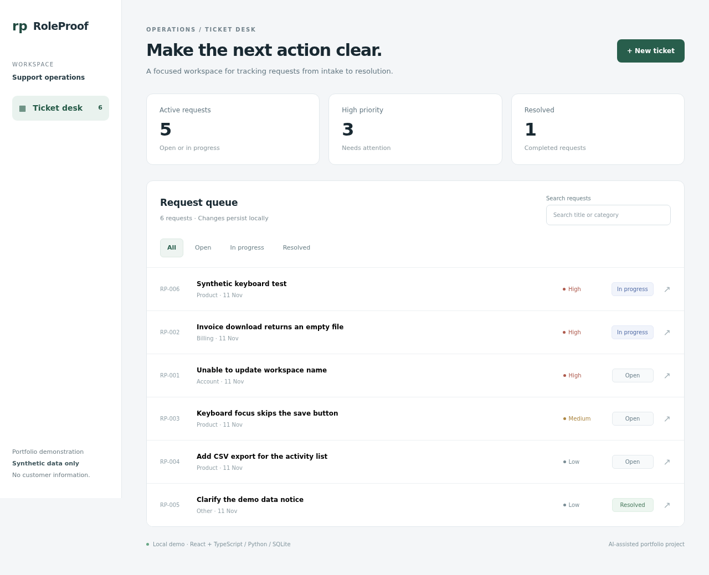
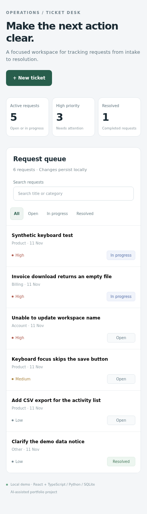

# RoleProof Desk

A focused support-operations portfolio demo: create fictional tickets, search and filter the queue, update status, and persist changes to SQLite. Responsive React + TypeScript frontend with a Python standard-library API and real database writes. No external API, model key, paid service or account is required.



<details><summary>Mobile preview</summary>



</details>

## Run locally

Requirements: Node.js 22 or later, npm, Python 3.10 or later.

```bash
npm ci --ignore-scripts
npm run build
python3 server.py
```

Open `http://127.0.0.1:8765`. The first start seeds five fictional tickets. Database writes persist across reloads/restarts in `roleproof.sqlite3`, which must not be committed. To reset, stop the server and delete that local database and its WAL/SHM files. Use only fictional data.

## Verify

```bash
npm run build
python3 -m unittest test_api -v
npx playwright install chromium
npm run test:e2e
npm audit
```

API tests create and remove their own temporary database. Browser tests start a wrapper that creates a unique temporary directory and database for that run, then cleans it on normal or termination-signal shutdown. No existing database is deleted. A hard kill can leave a disposable temporary directory; it never overwrites the normal demo database. Browser tests require the normal server to be stopped so port 8765 is available. Tests are local executions, not a claim that hosted CI has run.

Verified on the initial reviewed revision: production build and TypeScript pass; 13 API integration tests pass; 5 Chromium browser tests pass; dependency audit reports zero known vulnerabilities. The recorded output files in this repo show the actual checks. The initial dependency audit found Vite advisories; Vite was upgraded to 7.3.8 and the build/tests/audit rerun. An initial exact-label browser test failed, was fixed with explicit accessible select labels, and passed on rerun. Zero known dependency advisories is not a complete security audit.

## What the project demonstrates

- React components, typed ticket data, loading/error/empty states and accessible form labels.
- Responsive queue, status/priority treatment, keyboard dialog focus and Escape handling.
- Same-origin JSON API, strict field/enum/length validation and request-size limit.
- Parameterized SQLite queries and atomic version-based updates that reject stale writes with HTTP 409.
- API integration tests, browser persistence flow, responsive overflow checks and HTML-as-text regression.
- Host and Origin validation, custom mutation header, restrictive CSP and no arbitrary backend source/database file serving.

## Architecture

`main.tsx` is the React frontend; `style.css` provides the responsive layout. `server.py` serves the compiled `dist/` assets and `/api/health`, `/api/tickets`, `/api/tickets/:id`. `test_api.py` exercises the API with a real server and temporary SQLite database. `e2e_server.py` gives each browser run its own temporary database. `desk.spec.ts` drives Chromium through the actual built app. `package-lock.json` pins the dependency graph. Flat source layout keeps the small demonstration easy to inspect.

## Security and deployment limits

**This backend is intentionally loopback-only and has no login, authorization, rate limiting, TLS termination or multi-user isolation. It is not internet-hosting-ready.** Do not change the bind address to a public interface, use real data, proxy the write API onto the internet or claim production/SaaS readiness without adding those controls and reviewing them. The CSP/custom header/origin checks are defense in depth, not substitutes for authentication. No live penetration test or independent security audit has been performed.

`.env.example` contains only optional non-secret configuration defaults. Python reads environment variables directly; it does not auto-load `.env`. Relative ROLEPROOF_DB paths resolve from the project directory, independent of the shell working directory. No credential is needed. Do not put secrets into frontend variables: compiled browser code is public. `.gitignore` excludes local databases, actual env files, dependencies, compiled assets and browser artifacts. Public source availability is not a public backend deployment. No hosted backend or GitHub Pages deployment is claimed.

## Provenance and honest application use

This is an **AI-assisted project prepared for Ankush Singh's portfolio**. The initial implementation and local checks were produced with AI assistance. It is not evidence that Ankush independently wrote, tested or can explain every component. His personal contribution/learning should be recorded before describing it as independent experience. This is a portfolio/practice artifact, not an employer assessment. It makes no customer, revenue, security-certification or selection guarantee.

No existing project was cloned or rebranded to create this app. React, Vite, TypeScript, Playwright and npm dependencies remain subject to their own licenses and notices in the installed packages. This publication does not add a separate project-wide reuse license; ask the owner before redistributing project code. Screenshots show only fictional records and local test examples.

## Explain it in an interview

1. Walk a new ticket from React form validation through JSON, server validation and parameterized SQL to the returned row.
2. Explain how version-based updates prevent silently overwriting a stale ticket.
3. Show what a browser reload proves about persistence, and what the tests do not prove.
4. Explain why this backend must remain local until authentication, authorization and deployment controls are added.
5. Describe personal changes and AI assistance honestly. Do not add unsupported experience claims to a resume.
